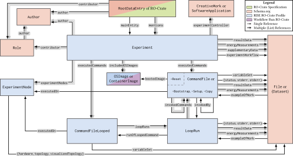

# Profile Information

**Name**: Research Infrastructure Shareable Experiments RO-Crate Profile (RISE RO-Crate Profile)

**Version**: 1.0.0

**Authors**:
- [Eric Hauser](https://orcid.org/0000-0002-5378-3905)
- [Kilian Warmuth](https://orcid.org/0000-0001-6328-1047)

## Overview

An RO-Crate profile for packaging metadata and artifacts of experiments conducted in research infrastructures. It defines a vocabulary to describe entities like executed commands, experiment nodes, and resulting data to enable transparent and reproducible experimentation.

## Resources

The following resources are part of this profile.

### Profile Definition

The following resources form the core definition of this profile:

- Profile Crate — [ro-crate-metadata.json](ro-crate-metadata.json)
- External type mappings — [types.csv](types.csv)
- Profile vocabulary — [vocabulary.csv](vocabulary.csv)
- JSON-LD context — [context.jsonld](context.jsonld)

### Developer Resources

The following resources help developers implement or verify crates against this profile:

- JSON Schema — [rise-ro-crate-profile-schema.json](rise-ro-crate-profile-schema.json)
- TypeScript interfaces — [rise-ro-crate-profile.ts](rise-ro-crate-profile.ts)
- Pydantic models — [rise_ro_crate_profile_pydantic.py](rise_ro_crate_profile_pydantic.py)

## Related Specifications

This profile builds upon the following specifications:

- [Schema.org](http://schema.org/)
- [Workflow Run Crate](https://w3id.org/ro/terms/workflow-run#)

## Vocabulary

### RootDataEntry
**Inherits from:** [Dataset](http://schema.org/Dataset) (Schema.org)  
**Description:** The root data entity that represents the crate, as defined by RO-Crate.

| Property | Property Source | Type | Type Source | Required? | Description |
| :--- | :--- | :--- | :--- | :--- | :--- |
| `@id` |  | [URL](http://schema.org/URL) | Schema.org | Required | Set to './' as defined by RO-Crate |
| `@type` |  | [Text](http://schema.org/Text) | Schema.org | Required | Set to the Dataset type as defined by RO-Crate |
| [`name`](http://schema.org/name) | Schema.org | [Text](http://schema.org/Text) | Schema.org | Required | Name of the crate |
| [`description`](http://schema.org/description) | Schema.org | [Text](http://schema.org/Text) | Schema.org | Optional | Description of the crate |
| [`dateCreated`](http://schema.org/dateCreated) | Schema.org | [DateTime](http://schema.org/DateTime) | Schema.org | Required | Creation timestamp |
| [`dateModified`](http://schema.org/dateModified) | Schema.org | [DateTime](http://schema.org/DateTime) | Schema.org | Required | Modification timestamp |
| [`datePublished`](http://schema.org/datePublished) | Schema.org | [DateTime](http://schema.org/DateTime) | Schema.org | Required | Publication timestamp |
| [`author`](http://schema.org/author) | Schema.org | List of ([Person](http://schema.org/Person) or [Organization](http://schema.org/Organization)) | Schema.org | Required | Authors of the crate |
| [`contributor`](http://schema.org/contributor) | Schema.org | List of ([Role](http://schema.org/Role)) | Schema.org | Optional | Authors of the crate with assigned roles |
| [`keywords`](http://schema.org/keywords) | Schema.org | List of ([Text](http://schema.org/Text)) | Schema.org | Optional | Keywords of the crate |
| [`license`](http://schema.org/license) | Schema.org | [URL](http://schema.org/URL) | Schema.org | Optional | License of the crate |
| [`archivedAt`](http://schema.org/archivedAt) | Schema.org | List of ([URL](http://schema.org/URL) or [WebPage](http://schema.org/WebPage)) | Schema.org | Optional | If copies of the crate are available online |
| [`citation`](http://schema.org/citation) | Schema.org | List of ([ScholarlyArticle](http://schema.org/ScholarlyArticle) or [CreativeWork](http://schema.org/CreativeWork)) | Schema.org | Optional | If the crate is used in publications |
| [`mainEntity`](http://schema.org/mainEntity) | Schema.org | [Experiment](https://tumi8.github.io/rise-ro-crate-profile/1.0.0/#experiment) | RISE RO-Crate Profile | Conditionally Required | If the crate contains a single experiment (mutually exclusive with mentions) |
| [`mentions`](http://schema.org/mentions) | Schema.org | List of ([Experiment](https://tumi8.github.io/rise-ro-crate-profile/1.0.0/#experiment)) | RISE RO-Crate Profile | Conditionally Required | If the crate contains multiple experiments (mutually exclusive with mainEntity) |

### Experiment
**Inherits from:** [CreativeWork](http://schema.org/CreativeWork) (Schema.org)  
**Description:** An experiment conducted in a research infrastructure.

| Property | Property Source | Type | Type Source | Required? | Description |
| :--- | :--- | :--- | :--- | :--- | :--- |
| `@id` |  | [URL](http://schema.org/URL) | Schema.org | Required | Local identifier (e.g. '#') or URI to the experiment file |
| `@type` |  | [Text](http://schema.org/Text) | Schema.org | Required | Set to the Experiment type |
| [`name`](http://schema.org/name) | Schema.org | [Text](http://schema.org/Text) | Schema.org | Conditionally Required | Name of the experiment (required if the crate contains multiple experiments) |
| [`description`](http://schema.org/description) | Schema.org | [Text](http://schema.org/Text) | Schema.org | Optional | Description of the experiment |
| [`dateCreated`](http://schema.org/dateCreated) | Schema.org | [DateTime](http://schema.org/DateTime) | Schema.org | Conditionally Required | Creation timestamp (required if the crate contains multiple experiments) |
| [`dateModified`](http://schema.org/dateModified) | Schema.org | [DateTime](http://schema.org/DateTime) | Schema.org | Conditionally Required | Modification timestamp (required if the crate contains multiple experiments) |
| [`author`](http://schema.org/author) | Schema.org | List of ([Person](http://schema.org/Person) or [Organization](http://schema.org/Organization)) | Schema.org | Conditionally Required | Authors of the experiment (required if the crate contains multiple experiments) |
| [`contributor`](http://schema.org/contributor) | Schema.org | List of ([Role](http://schema.org/Role)) | Schema.org | Optional | Authors of the experiment with assigned roles |
| [`keywords`](http://schema.org/keywords) | Schema.org | List of ([Text](http://schema.org/Text)) | Schema.org | Optional | Keywords of the experiment |
| [`encodingFormat`](http://schema.org/encodingFormat) | Schema.org | [Text](http://schema.org/Text) or [URL](http://schema.org/URL) | Schema.org | Optional | If the identifier is a URI to a file |
| `executedCommands` | RISE RO-Crate Profile | List of ([CommandFile](https://tumi8.github.io/rise-ro-crate-profile/1.0.0/#commandfile) or [CommandFileLooped](https://tumi8.github.io/rise-ro-crate-profile/1.0.0/#commandfilelooped) or [CommandFileReset](https://tumi8.github.io/rise-ro-crate-profile/1.0.0/#commandfilereset) or [CommandFileBootstrap](https://tumi8.github.io/rise-ro-crate-profile/1.0.0/#commandfilebootstrap) or [CommandFileSetup](https://tumi8.github.io/rise-ro-crate-profile/1.0.0/#commandfilesetup) or [CommandFileCopy](https://tumi8.github.io/rise-ro-crate-profile/1.0.0/#commandfilecopy)) | RISE RO-Crate Profile | Required | Executed commands on the experiment nodes |
| `resultData` | RISE RO-Crate Profile | List of ([File](#file) or [Dataset](#dataset)) | Schema.org | Optional | Links to result data of the executed commands |
| `experimentNodes` | RISE RO-Crate Profile | List of ([ExperimentNode](https://tumi8.github.io/rise-ro-crate-profile/1.0.0/#experimentnode)) | RISE RO-Crate Profile | Required | Experiment nodes that are part of the experiment |
| `experimentWorkflow` | RISE RO-Crate Profile | [File](#file) | Schema.org | Optional | Link to a file that describes the experiment workflow |
| `supplementaryData` | RISE RO-Crate Profile | List of ([File](#file) or [Dataset](#dataset)) | Schema.org | Optional | Links to additional data that is relevant to the experiment |
| `includedOSImages` | RISE RO-Crate Profile | List of ([OSImage](https://tumi8.github.io/rise-ro-crate-profile/1.0.0/#osimage)) | RISE RO-Crate Profile | Optional | OS images that are part of the experiment |
| `energyMeasurements` | RISE RO-Crate Profile | List of ([File](#file) or [Dataset](#dataset)) | Schema.org | Optional | Links to energy measurement data of the executed commands |
| `experimentController` | RISE RO-Crate Profile | List of ([CreativeWork](http://schema.org/CreativeWork) or [SoftwareApplication](http://schema.org/SoftwareApplication)) | Schema.org | Required | Software or tools used for the experiment management and execution |

### File
**Inherits from:** [File](http://schema.org/MediaObject) (Schema.org)  
**Description:** An RO-Crate data entity for files. Defined as an alias for the Schema.org MediaObject type, listed here for reference.

| Property | Property Source | Type | Type Source | Required? | Description |
| :--- | :--- | :--- | :--- | :--- | :--- |
| `@id` |  | [URL](http://schema.org/URL) | Schema.org | Required | Relative or absolute URI to file |
| `@type` |  | [Text](http://schema.org/Text) | Schema.org | Required | Set to the File type as defined by RO-Crate |
| [`name`](http://schema.org/name) | Schema.org | [Text](http://schema.org/Text) | Schema.org | Required | Filename or human-readable name |
| [`description`](http://schema.org/description) | Schema.org | [Text](http://schema.org/Text) | Schema.org | Optional | Description of the file |
| [`keywords`](http://schema.org/keywords) | Schema.org | List of ([Text](http://schema.org/Text)) | Schema.org | Optional | Keywords of the file |
| [`contentSize`](http://schema.org/contentSize) | Schema.org | [Text](http://schema.org/Text) | Schema.org | Required | File size in bytes |
| [`dateCreated`](http://schema.org/dateCreated) | Schema.org | [DateTime](http://schema.org/DateTime) | Schema.org | Required | Creation timestamp |
| [`dateModified`](http://schema.org/dateModified) | Schema.org | [DateTime](http://schema.org/DateTime) | Schema.org | Required | Modification timestamp |
| [`encodingFormat`](http://schema.org/encodingFormat) | Schema.org | [Text](http://schema.org/Text) or [URL](http://schema.org/URL) | Schema.org | Optional | IANA mediatype or link to contextual entry |
| [`exampleOfWork`](http://schema.org/exampleOfWork) | Schema.org | [CommandFile](https://tumi8.github.io/rise-ro-crate-profile/1.0.0/#commandfile) or [LoopRun](https://tumi8.github.io/rise-ro-crate-profile/1.0.0/#looprun) | RISE RO-Crate Profile | Optional | If the file is part of a CommandFile or LoopRun |

### Dataset
**Inherits from:** [Dataset](http://schema.org/Dataset) (Schema.org)  
**Description:** An RO-Crate data entity for directories, listed here for reference.

| Property | Property Source | Type | Type Source | Required? | Description |
| :--- | :--- | :--- | :--- | :--- | :--- |
| `@id` |  | [URL](http://schema.org/URL) | Schema.org | Required | Relative or absolute URI to directory |
| `@type` |  | [Text](http://schema.org/Text) | Schema.org | Required | Set to the Dataset type as defined by RO-Crate |
| [`name`](http://schema.org/name) | Schema.org | [Text](http://schema.org/Text) | Schema.org | Required | Directory name or human-readable name |
| [`description`](http://schema.org/description) | Schema.org | [Text](http://schema.org/Text) | Schema.org | Optional | Description of the directory |
| [`keywords`](http://schema.org/keywords) | Schema.org | List of ([Text](http://schema.org/Text)) | Schema.org | Optional | Keywords of the directory |
| [`contentSize`](http://schema.org/contentSize) | Schema.org | [Text](http://schema.org/Text) | Schema.org | Optional | Directory size in bytes |
| [`dateCreated`](http://schema.org/dateCreated) | Schema.org | [DateTime](http://schema.org/DateTime) | Schema.org | Required | Creation timestamp |
| [`dateModified`](http://schema.org/dateModified) | Schema.org | [DateTime](http://schema.org/DateTime) | Schema.org | Required | Modification timestamp |
| [`hasPart`](http://schema.org/hasPart) | Schema.org | List of ([File](#file) or [Dataset](#dataset)) | Schema.org | Optional | Links to files in the directory |
| [`exampleOfWork`](http://schema.org/exampleOfWork) | Schema.org | [CommandFile](https://tumi8.github.io/rise-ro-crate-profile/1.0.0/#commandfile) or [LoopRun](https://tumi8.github.io/rise-ro-crate-profile/1.0.0/#looprun) | RISE RO-Crate Profile | Optional | If the directory is part of a CommandFile or LoopRun |

### CommandFile
**Inherits from:** [File](https://tumi8.github.io/rise-ro-crate-profile/1.0.0/#file) (RISE RO-Crate Profile)  
**Description:** A file containing commands to be executed on an experiment node.

| Property | Property Source | Type | Type Source | Required? | Description |
| :--- | :--- | :--- | :--- | :--- | :--- |
| [`startTime`](http://schema.org/startTime) | Schema.org | [DateTime](http://schema.org/DateTime) | Schema.org | Required | Timestamp when the command starts |
| [`endTime`](http://schema.org/endTime) | Schema.org | [DateTime](http://schema.org/DateTime) | Schema.org | Required | Timestamp when the command finishes |
| [`duration`](http://schema.org/duration) | Schema.org | [Duration](http://schema.org/Duration) | Schema.org | Required | Duration of the command |
| `executedOn` | RISE RO-Crate Profile | [ExperimentNode](https://tumi8.github.io/rise-ro-crate-profile/1.0.0/#experimentnode) | RISE RO-Crate Profile | Required | Experiment node executing the command |
| `variableSet` | RISE RO-Crate Profile | [File](#file) | Schema.org | Optional | Link to a variable set file |
| `status` | RISE RO-Crate Profile | [Text](http://schema.org/Text) or [File](#file) | Schema.org | Required | Return code or link to the status file |
| `stdout` | RISE RO-Crate Profile | [File](#file) | Schema.org | Required | Link to the stdout file |
| `stderr` | RISE RO-Crate Profile | [File](#file) | Schema.org | Required | Link to the stderr file |
| `resultData` | RISE RO-Crate Profile | List of ([File](#file) or [Dataset](#dataset)) | Schema.org | Optional | Links to result data |
| `invokedCommands` | RISE RO-Crate Profile | List of ([CommandFile](https://tumi8.github.io/rise-ro-crate-profile/1.0.0/#commandfile)) | RISE RO-Crate Profile | Optional | Links to invoked subcommands |
| `invokedBy` | RISE RO-Crate Profile | [CommandFile](https://tumi8.github.io/rise-ro-crate-profile/1.0.0/#commandfile) or [LoopRun](https://tumi8.github.io/rise-ro-crate-profile/1.0.0/#looprun) | RISE RO-Crate Profile | Optional | If the command is invoked by a parent command |
| `energyMeasurements` | RISE RO-Crate Profile | List of ([File](#file) or [Dataset](#dataset)) | Schema.org | Optional | Links to energy measurement data |

### CommandFileLooped
**Inherits from:** [File](https://tumi8.github.io/rise-ro-crate-profile/1.0.0/#file) (RISE RO-Crate Profile)  
**Description:** A command file that iterates over an array of parameters.

| Property | Property Source | Type | Type Source | Required? | Description |
| :--- | :--- | :--- | :--- | :--- | :--- |
| [`startTime`](http://schema.org/startTime) | Schema.org | [DateTime](http://schema.org/DateTime) | Schema.org | Required | Timestamp when the command starts |
| [`endTime`](http://schema.org/endTime) | Schema.org | [DateTime](http://schema.org/DateTime) | Schema.org | Required | Timestamp when the command finishes |
| [`duration`](http://schema.org/duration) | Schema.org | [Duration](http://schema.org/Duration) | Schema.org | Required | Duration of the command |
| `executedOn` | RISE RO-Crate Profile | [ExperimentNode](https://tumi8.github.io/rise-ro-crate-profile/1.0.0/#experimentnode) | RISE RO-Crate Profile | Required | Experiment node executing the command |
| `variableSet` | RISE RO-Crate Profile | [File](#file) | Schema.org | Optional | Link to a variable set file |
| `loopRuns` | RISE RO-Crate Profile | List of ([LoopRun](https://tumi8.github.io/rise-ro-crate-profile/1.0.0/#looprun)) | RISE RO-Crate Profile | Required | Links to the individual loop runs |

### LoopRun
**Inherits from:** [File](https://tumi8.github.io/rise-ro-crate-profile/1.0.0/#file) (RISE RO-Crate Profile)  
**Description:** A single run of a looped command file.

| Property | Property Source | Type | Type Source | Required? | Description |
| :--- | :--- | :--- | :--- | :--- | :--- |
| [`startTime`](http://schema.org/startTime) | Schema.org | [DateTime](http://schema.org/DateTime) | Schema.org | Required | Timestamp when the run starts |
| [`endTime`](http://schema.org/endTime) | Schema.org | [DateTime](http://schema.org/DateTime) | Schema.org | Required | Timestamp when the run finishes |
| [`duration`](http://schema.org/duration) | Schema.org | [Duration](http://schema.org/Duration) | Schema.org | Required | Duration of the run |
| `runOfLoopedCommand` | RISE RO-Crate Profile | [CommandFileLooped](https://tumi8.github.io/rise-ro-crate-profile/1.0.0/#commandfilelooped) | RISE RO-Crate Profile | Required | Link to the looped command file |
| `status` | RISE RO-Crate Profile | [Text](http://schema.org/Text) or [File](#file) | Schema.org | Required | Return code or link to the status file |
| `stdout` | RISE RO-Crate Profile | [File](#file) | Schema.org | Required | Link to the stdout file |
| `stderr` | RISE RO-Crate Profile | [File](#file) | Schema.org | Required | Link to the stderr file |
| `resultData` | RISE RO-Crate Profile | List of ([File](#file) or [Dataset](#dataset)) | Schema.org | Optional | Links to result data |
| `invokedCommands` | RISE RO-Crate Profile | List of ([CommandFile](https://tumi8.github.io/rise-ro-crate-profile/1.0.0/#commandfile)) | RISE RO-Crate Profile | Optional | Links to invoked subcommands |
| `energyMeasurements` | RISE RO-Crate Profile | List of ([File](#file) or [Dataset](#dataset)) | Schema.org | Optional | Links to energy measurement data |

### CommandFileBootstrap
**Inherits from:** [CommandFile](https://tumi8.github.io/rise-ro-crate-profile/1.0.0/#commandfile) (RISE RO-Crate Profile)  
**Description:** A command file for bootstrapping an experiment node.

| Property | Property Source | Type | Type Source | Required? | Description |
| :--- | :--- | :--- | :--- | :--- | :--- |

### CommandFileSetup
**Inherits from:** [CommandFile](https://tumi8.github.io/rise-ro-crate-profile/1.0.0/#commandfile) (RISE RO-Crate Profile)  
**Description:** A command file for setting up an experiment node.

| Property | Property Source | Type | Type Source | Required? | Description |
| :--- | :--- | :--- | :--- | :--- | :--- |

### CommandFileReset
**Inherits from:** [CommandFile](https://tumi8.github.io/rise-ro-crate-profile/1.0.0/#commandfile) (RISE RO-Crate Profile)  
**Description:** A command file for resetting an experiment node.

| Property | Property Source | Type | Type Source | Required? | Description |
| :--- | :--- | :--- | :--- | :--- | :--- |
| `bootedImage` | RISE RO-Crate Profile | [OSImage](https://tumi8.github.io/rise-ro-crate-profile/1.0.0/#osimage) or [ContainerImage](https://w3id.org/ro/terms/workflow-run#ContainerImage) | RISE RO-Crate Profile, Workflow Run Crate | Required | Link to the booted image |
| `bootParameters` | RISE RO-Crate Profile | List of ([Text](http://schema.org/Text)) | Schema.org | Optional | List of boot parameters |
| `bootstrapCommands` | RISE RO-Crate Profile | List of ([CommandFileBootstrap](https://tumi8.github.io/rise-ro-crate-profile/1.0.0/#commandfilebootstrap)) | RISE RO-Crate Profile | Optional | Links to invoked bootstrap commands |
| `setupCommands` | RISE RO-Crate Profile | List of ([CommandFileSetup](https://tumi8.github.io/rise-ro-crate-profile/1.0.0/#commandfilesetup)) | RISE RO-Crate Profile | Optional | Links to invoked setup commands |

### OSImage
**Inherits from:** [OperatingSystem](http://schema.org/OperatingSystem) (Schema.org)  
**Description:** An operating system image booted on an experiment node.

| Property | Property Source | Type | Type Source | Required? | Description |
| :--- | :--- | :--- | :--- | :--- | :--- |
| [`name`](http://schema.org/name) | Schema.org | [Text](http://schema.org/Text) | Schema.org | Required | Name of the image |
| [`description`](http://schema.org/description) | Schema.org | [Text](http://schema.org/Text) | Schema.org | Optional | Description of the image |
| [`fileSize`](http://schema.org/fileSize) | Schema.org | [Text](http://schema.org/Text) | Schema.org | Required | Size of the image |
| [`archivedAt`](http://schema.org/archivedAt) | Schema.org | [URL](http://schema.org/URL) | Schema.org | Optional | If the image is available online |
| [`hasPart`](http://schema.org/hasPart) | Schema.org | List of ([File](#file) or [Dataset](#dataset)) | Schema.org | Optional | Links to image data if included in the crate |

### CommandFileCopy
**Inherits from:** [CommandFile](https://tumi8.github.io/rise-ro-crate-profile/1.0.0/#commandfile) (RISE RO-Crate Profile)  
**Description:** A command file for copying data to an experiment node.

| Property | Property Source | Type | Type Source | Required? | Description |
| :--- | :--- | :--- | :--- | :--- | :--- |
| `sourcePath` | RISE RO-Crate Profile | [Text](http://schema.org/Text) | Schema.org | Required | Source path of the data to be copied |
| `destinationPath` | RISE RO-Crate Profile | [Text](http://schema.org/Text) | Schema.org | Required | Destination path of the data to be copied |
| `recursiveCopy` | RISE RO-Crate Profile | [Boolean](http://schema.org/Boolean) | Schema.org | Required | If the data is copied recursively |
| `copiedData` | RISE RO-Crate Profile | List of ([File](#file) or [Dataset](#dataset)) | Schema.org | Optional | Links to copied data if included in the crate |

### ExperimentNode
**Inherits from:** [Thing](http://schema.org/Thing) (Schema.org)  
**Description:** An experiment node of a research infrastructure.

| Property | Property Source | Type | Type Source | Required? | Description |
| :--- | :--- | :--- | :--- | :--- | :--- |
| `@id` |  | [Text](http://schema.org/Text) | Schema.org | Required | Local identifier (e.g. '#') or URI of the experiment node |
| `@type` |  | [Text](http://schema.org/Text) | Schema.org | Required | Set to the Thing type |
| [`name`](http://schema.org/name) | Schema.org | [Text](http://schema.org/Text) | Schema.org | Required | Hostname of the experiment node |
| [`description`](http://schema.org/description) | Schema.org | [Text](http://schema.org/Text) | Schema.org | Optional | Description of the experiment node |
| `hardware` | RISE RO-Crate Profile | [File](#file) | Schema.org | Optional | Link to a hardware file of the experiment node |
| `topology` | RISE RO-Crate Profile | [File](#file) | Schema.org | Optional | Link to a network topology file of the experiment node |
| `visualizedTopology` | RISE RO-Crate Profile | [File](#file) | Schema.org | Optional | Link to a visualized network topology file of the experiment node |
